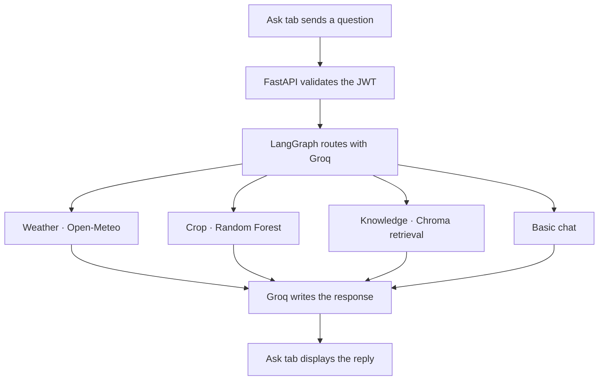

# Smart Farming Assistant architecture

## Browser and backend

The browser serves a static HTML and JavaScript page. It sends requests to FastAPI. After login, it includes the returned JWT as a bearer token on protected requests.

| Browser action | API endpoint | Processing |
| --- | --- | --- |
| Register | `POST /auth/register` | Hash the password and create a user record. |
| Login | `POST /auth/login` | Check credentials and return a JWT. |
| Ask a question | `POST /agent/chat` | Run LangGraph routing and return an answer. |
| Recommend a crop | `POST /crop/recommend` | Validate seven inputs and rank predictions from the saved Random Forest model. |
| Upload a leaf | `POST /disease/detect` | Resize and normalize the image, then rank predictions from the saved MobileNetV2 model. |

The API also exposes `GET /auth/me`, `GET /farms/`, `POST /farms/` and `POST /rag/ask`. SQLite is the default store for users and farms. Chroma stores document chunks and embeddings.

## Ask request flow

For farming knowledge questions, the agent embeds the question with `all-MiniLM-L6-v2` and retrieves up to four chunks from the `farming` collection. Groq receives the retrieved text and a prompt to answer from that text. The direct `/rag/ask` endpoint uses the same collection and embedding model.

For weather, the tool resolves the city through Open-Meteo geocoding and prefers a Pakistan match when available. It then requests current temperature and a three-day forecast. The router prompt includes aliases such as FSD for Faisalabad.

## Building the knowledge base

`rag/ingest.py` reads text, Markdown and PDF files from `data/farming_docs/`. It splits them into overlapping chunks, embeds them with `all-MiniLM-L6-v2`, and writes the text, vectors and source filenames to `rag/chroma_db/`. Run ingestion with the backend stopped, then start the backend so it opens the new collection.

## Prediction models

| Model | Artifact | Output |
| --- | --- | --- |
| Crop Random Forest | `ml/crop_model.joblib` | Top three crop classes and model scores |
| Leaf MobileNetV2 | `ml/disease_model.pt` and `ml/disease_classes.json` | Top three leaf classes, model scores and a confidence flag based on a 60% cutoff |

The leaf classifier runs through its own API endpoint. The Ask flow routes weather, crop, knowledge and basic chat requests.
